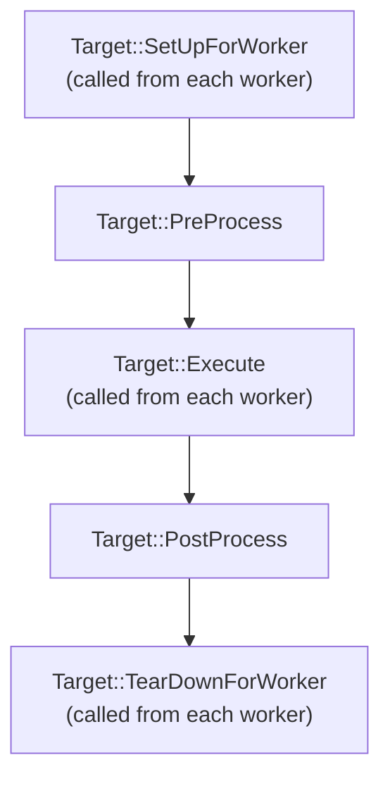

# C++ Benchmarker

[](https://github.com/dbgroup-nagoya-u/cpp-benchmark/actions/workflows/ubuntu_24.yaml) [](https://github.com/dbgroup-nagoya-u/cpp-benchmark/actions/workflows/ubuntu_22.yaml) [](https://github.com/dbgroup-nagoya-u/cpp-benchmark/actions/workflows/mac.yaml)

- [Build](#build)
    - [Prerequisites](#prerequisites)
    - [Build Options](#build-options)
    - [Build and Run Unit Tests](#build-and-run-unit-tests)
- [Usage](#usage)
    - [Linking by CMake](#linking-by-cmake)
    - [Preventing Compiler Optimizations](#preventing-compiler-optimizations)
    - [Flowchart of User-defined Functions in RunBench](#flowchart-of-user-defined-functions-in-runbench)
    - [Definitions of Measured Values](#definitions-of-measured-values)
- [Acknowledgments](#acknowledgments)

## Build

### Prerequisites

```bash
sudo apt update && sudo apt install -y build-essential cmake
cd <path_to_your_workspace>
git clone git@github.com:dbgroup-nagoya-u/cpp-benchmark.git
```

### Build Options

#### Parameters for Unit Testing

- `CPP_BENCH_BUILD_TESTS`: build unit tests for this repository if `ON` (default: `OFF`).
- `DBGROUP_TEST_THREAD_NUM`: the maximum number of threads to perform unit tests (default `2`).

### Build and Run Unit Tests

```bash
mkdir build && cd build
cmake .. -DCMAKE_BUILD_TYPE=Release -DCPP_BENCH_BUILD_TESTS=ON
cmake --build . --parallel --config Release
ctest -C Release
```

## Usage

### Linking by CMake

Add this library to your build in `CMakeLists.txt`.

```cmake
FetchContent_Declare(
    cpp-benchmark
    GIT_REPOSITORY "https://github.com/dbgroup-nagoya-u/cpp-benchmark.git"
    GIT_TAG "<commit_tag_you_want_to_use>"
)
FetchContent_MakeAvailable(cpp-benchmark)

add_executable(
  <target_bin_name>
  [<source> ...]
)
target_link_libraries(<target_bin_name> PRIVATE
  dbgroup::cpp_benchmark
)
```

### Preventing Compiler Optimizations

Compilers may remove computations whose results are never used (e.g., the sum of read values in `Target::Execute`), and then benchmarks measure nothing. Pass such results to `dbgroup::benchmark::DoNotOptimize` (defined in `dbgroup/benchmark/utility.hpp`) to retain them. This function is based on `benchmark::DoNotOptimize` in [Google Benchmark](https://github.com/google/benchmark).

```cpp
size_t sum = 0;
for (size_t i = 0; i < kElementNum; ++i) {
  sum += page.values[i];
}
::dbgroup::benchmark::DoNotOptimize(sum);
```

### Flowchart of User-defined Functions in RunBench



### Definitions of Measured Values

This benchmarker is designed to compare the relative performance of operations whose latency ranges from hundreds of nanoseconds to several microseconds.

- **Latency**: Each worker measures only the duration of each `Target::Execute` call. Preparation for each operation (i.e., generating it with `OperationEngine::OPIter`) is excluded from measurements because it depends on workloads. If `Target::Execute` returns `n > 1` (e.g., the number of records read by a scan), the measured duration divided by `n` is recorded as the latency of `n` executions.
- **Percentile latency**: Latency is recorded in a fixed-size sketch based on DDSketch, so percentiles are approximate with a relative error of about 0.7%.
- **Throughput**: The total number of executions is divided by the average measured duration per worker (i.e., the sum of measured durations divided by the number of workers). Thus, throughput is another view of average latency rather than wall-clock throughput, and it is intended for relative comparisons. Throughput of each operation type is computed only from the measured durations of that type, so the sum of them does not necessarily equal the total throughput.
- **Termination**: Each worker stops when its `OperationEngine::OPIter` runs out of operations (e.g., in workloads that build or destroy an index) or when a timeout expires (see `Builder::SetTimeOut`), whichever comes first. When the timeout expires, each worker stops after completing its current operation. Note that if some workers finish earlier than others, the remaining workers run with lower contention. Thus, in workloads measured until a timeout, let `OperationEngine::OPIter` generate enough operations so that no worker runs out of them before the timeout.
- **Overheads**: Each measured duration includes the overhead of reading a clock (typically tens of nanoseconds), which is not negligible for operations shorter than hundreds of nanoseconds.

## Acknowledgments

This work is based on results obtained from project JPNP16007 commissioned by the New Energy and Industrial Technology Development Organization (NEDO). In addition, this work was supported partly by KAKENHI (16H01722 and 20K19804).

We used Claude, a generative AI model developed by Anthropic, to assist with development tasks such as debugging.
